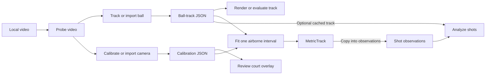

# Snufspin architecture

This document describes `main` at `e7dc40c`. Snufspin analyzes local tennis video from a single fixed camera. Its current workflow produces a 2D ball track, a court mapping or full camera, an optional 3D fit for one annotated airborne interval, and per-shot labels and average speed from supplied observations. Each step runs independently through `python -m snufspin`, so the same cached track or camera can be reused across reviews and experiments. [CLI entry point](../snufspin/__main__.py#L37)

## 1. Pipeline and data contracts

| Artifact | Contents and consumers |
| --- | --- |
| **Video timeline** | `probe` reports the encoded dimensions, frame count and one relative timestamp per frame. The in-memory `Video` also stores the source path and original first PTS. [Video and probing](../snufspin/video.py#L9) |
| **Ball track** | Version 1 JSON with the input SHA-256, dimensions, frame count, full timestamp sequence, producer metadata in `source` and a sparse `ball_track` array. Each point has `frame`, `x_px`, `y_px`, `provenance` and optional `confidence`. Consumers check the hash and frame metadata, enforce at most one in-bounds point per frame, and accept `manual`, `measured`, `interpolated` or `predicted` provenance. A missing frame is represented by an absent point. [Track format and validation](../snufspin/tracking.py#L27) |
| **Calibration** | Version 1 JSON with the input SHA-256, dimensions, frame count, court model, source, `court_mapping` and nullable `camera`. The mapping contains a homography and optional intrinsics for distortion handling. The camera contains `K`, `R`, `t` and optional distortion coefficients. The reader checks clip identity and court-model version. [Calibration format](../snufspin/calibration.py#L145) |
| **Shot observations** | A user-supplied sidecar with required `shots`, optional inline `ball_track` and optional `source`. A shot has `contact_frame`, `end_frame`, optional `end_event`, optional labels and optional `metric_track`. `analyze --ball-track` uses the video-bound track in place of the inline points. [Observation reader](../snufspin/__main__.py#L19) · [Example sidecar](../examples/synthetic-observations.json) |
| **Metric track** | A method string and ordered samples with `frame`, `x_m`, `y_m` and `z_m`. The `metric_track` field in a successful flight report can be copied into its shot in the observations sidecar. `analyze` reads the shot sidecar and the optional ball track. [MetricTrack](../snufspin/pipeline.py#L17) · [Flight report](../snufspin/__main__.py#L87) |

All frame indexes are **zero-based in presentation order**. FFprobe reads the first video stream's best-effort presentation timestamps. The reader requires finite, strictly increasing timestamps and subtracts the first one. Interpolation, trajectory fitting and speed use those timestamps, including on variable-frame-rate video. All image coordinates are pixels in the encoded frame, with the origin at the top left. Bake orientation into the source pixels before using footage that relies on display rotation. [Timeline normalization](../snufspin/video.py#L23) · [Decode paths](../snufspin/video.py#L53)

Tracking streams full-size BGR frames from OpenCV with automatic rotation disabled and checks the decoded size and count against the probe. Court sampling uses FFmpeg with rotation disabled. For a nonzero sample index, it seeks halfway between the preceding and target PTS to avoid rounding past the target. It validates the returned image size before passing the frame to a detector. [Video decoding](../snufspin/video.py#L53)

## 2. Ball tracking

### 2.1 Default WASB Tennis

1. **Load the official adapter inputs.** `track` (also `track-wasb`) uses the WASB-SBDT checkout at `923462c` and the official Tennis checkpoint. The adapter checks the revision, a clean upstream `src` tree and the checkpoint SHA-256. It loads the upstream model, preprocessing, postprocessor and online tracker configuration. CPU with four threads is the default. `--device` also accepts CUDA and MPS. [WASB adapter setup](../snufspin/wasb.py#L38)
2. **Predict overlapping windows.** Convert BGR to RGB, apply WASB's affine warp to 512 × 288 and apply the upstream ImageNet normalization. Inference uses one three-frame window per forward pass, at stride 1. Interior source frames can receive candidates from three windows. The beginning and end receive fewer contributions, and clips shorter than three frames supply no complete window. [Preprocessing and model output](../snufspin/wasb.py#L71) · [Window aggregation](../snufspin/wasb.py#L17)
3. **Decode and select one point.** The upstream postprocessor applies a **0.5 heatmap threshold**, weighted connected components and the inverse affine mapping to source pixels. For each frame, the adapter pools all candidate lists before calling the online tracker once. The pinned tracker chooses the highest-scoring candidate that passes its **300-source-pixel displacement gate** when the gate applies. The adapter emits the selected visible, in-bounds point as `measured`, with confidence left null. No winner leaves the frame blank. The report records decoder settings and model provenance so the track can be reproduced. [Selection and report](../snufspin/wasb.py#L104) · [Pinned online tracker](https://github.com/nttcom/WASB-SBDT/blob/923462cacdeb3353b84ddebdedb3f4b7a8553b0f/src/trackers/online.py)

### 2.2 Other sources and gap handling

- **TrackNet** is available through `track --model-source PATH --weights PATH`. It stacks three 640 × 360 BGR frames newest first and decodes the per-pixel argmax heatmap with the legacy byte conversion, binary threshold and Hough circles. It selects the first circle that passes the previous-position gate in source pixels. The first two frames have no prediction. A miss clears the previous point for the next iteration. [Legacy decoder and inference](../snufspin/tracknet.py#L21)
- **tennis-vision import** reads the numeric Phase 1 `upstream.npz` with pickle disabled. It requires a float pair for every frame, accepts pairs of NaNs as missing, and verifies the frame count and video hash before returning the shared track format. [NPZ importer](../snufspin/tennis_vision.py#L10)
- **Short-gap interpolation** is an explicit `interpolate-track` step over a cached track. It fills empty interior frames bracketed by measured or manual points, with endpoint separation at most **0.15 s** by default. It interpolates by elapsed time. Existing inferred samples block interpolation across that interval. Leading and trailing gaps stay empty. New points carry `interpolated` provenance. [Gap interpolation](../snufspin/repair.py#L11)

### 2.3 Rendering and tracking evaluation

`render` draws a box at each saved point and hides it on empty frames. Interpolated points are gold and other saved points are lime. FFmpeg schedules changes between adjacent frame timestamps and keeps variable frame timing in the video-only output. It pads odd dimensions on the bottom or right and writes a separate H.264 MP4. [Tracking overlay](../snufspin/overlay.py#L9)

`evaluate-track` scores the frames explicitly labeled in a review file. It checks video identity and label timestamps, counts visible misses and hidden-frame detections, and reports localization counts within **5, 10 and 20 source px**. Rows include point provenance and error when a visible label has a prediction. The frozen tracking fixtures serve as regression cases from manually selected reviews. Estimating whole-clip precision and recall requires representative annotations. The separate `python -m snufspin.diagnostics` command replays legacy TrackNet on reviewed frames, verifies the cached winner and reports Hough candidates, gate failures and connected-component alternatives using the cached history. [Evaluation](../snufspin/evaluation.py#L9) · [Candidate diagnostics](../snufspin/diagnostics.py#L15) · [Tracking benchmark archive](../benchmarks/tracking/README.md)

## 3. Court and camera calibration

### 3.1 Geometry and inputs

The metric court is **23.77 m** long and **10.97 m** wide, with **8.23 m** between singles sidelines. World `x` runs from `baseline_a` to `baseline_b`, `y` runs across the court from the low to high sideline, and the surface is `z = 0`. The net plane is at `x = 11.885 m`. The template has nine named painted lines and fourteen named crossings. Automatic line matching chooses the court orientation from its template conventions. Its labels can differ from an external reference by a 180° rotation. [Metric template](../snufspin/court.py#L1) · [Rectangle ordering](../snufspin/line_court.py#L43)

`calibrate-court` defaults to **TEXflip LETR + `vp-segments` with GeoCalib intrinsics**. It selects **seven** evenly spaced presentation-frame indexes by default, including the endpoints, capped by clip length. The detector uses TEXflip's BGR normalization and resizes the short side to 1100 px. It keeps segment predictions with class probability at least **0.5** and scales normalized endpoints into source pixels. Before fitting, eligible fragments are refined toward nearby bright paint. The refinement samples across the line, fits a robust axis to sufficiently strong ridges spread along the fragment, and keeps the original proposal if support or endpoint movement fails its bounds. Both solvers discard fragments shorter than **6% of the shorter image dimension** during matching. [CLI and sampling](../snufspin/court_commands.py#L21) · [LETR inference](../snufspin/letr.py#L60) · [Segment refinement and preparation](../snufspin/line_court.py#L82)

When `--solver` is omitted, `--detector heatmap`, `--landmarks`, or `--paint-fallback` select the crossings solver. The legacy heatmap detector uses 640 × 360 BGR frames and named output channels. For each landmark it uses the centroid of the component containing the peak at a **0.67** threshold and a minimum area of **4 px** in the heatmap. Manual input maps frame indexes to named source-pixel crossings, and the CLI adds those indexes to the regular sample set for validation. An explicit `--intrinsics` file can provide either solver with a `K` in decoded pixels with matching width and height. The segment solver requires a pinhole camera with zero distortion. [Heatmap decoder](../snufspin/court_detector.py#L48) · [Calibration input routing](../snufspin/court_commands.py#L136)

### 3.2 Alternate solver using named crossings

1. **Match the court template.** With LETR, sort eligible segments by length and partition them using `abs(dy) / length <= 0.38` for transverse fragments. Use at most 12 per family to generate proposals. Pairs from both families define candidate quadrilaterals via intersections. Match them to rectangles in the metric template, project the full court and rank by one-to-one line assignment. The template proposal needs at least four matches with weight **≥ 0.35**. Intersect the matched observed lines to produce named crossings. Keep crossings inside the image and within `max(12 px, width / 40)` of both fragments' extents. Heatmap and manual inputs enter directly as crossings. [Rectangle and template matching](../snufspin/line_court.py#L139) · [Observed crossings](../snufspin/line_court.py#L204)
2. **Fit and validate each frame's plane.** Fit a court-to-image homography with RANSAC at `T = max(3 px, width / 240)`. If intrinsics are supplied, fit in undistorted pixels. Require at least four distinct landmarks, at least four inliers and at least **60%** inliers. The four doubles corners must lie on one side of the homography horizon. Check projected markings in the source image using a brightness peak against both local flanks. This check uses a 101-point court grid per marking, a search radius of `max(3 px, round(width / 240))`, and at least 12 visible sample neighborhoods per marking. A marking needs bright ridges on at least half its samples, with a brightness margin of **12**. A frame needs at least three supported markings, including one in each court direction. [RANSAC](../snufspin/court_fit.py#L24) · [Crossings paint check](../snufspin/court_review.py#L16)
3. **Require a consistent clip-wide mapping.** Compare each pair of independently supported homographies on the union of their inlier landmark names. Reject if any pair's p90 projection difference exceeds `2T`. Pool the individual inliers, refit with RANSAC and run the same marking check on every sampled frame. The pooled mapping needs at least two supporting frames and a strict majority of samples. [Shared plane checks](../snufspin/court_fit.py#L102)
4. **Recover pose when independent estimates agree.** Use supplied intrinsics where available. Otherwise estimate one focal length per supported frame from the orthogonality of the homography's two vanishing directions, assuming centered principal point, square pixels and negligible distortion. Near-infinite vanishing directions and focal lengths outside **0.25–5 times the image width** fail this estimate. For each usable `K`, try planar IPPE pose solutions and refine with Levenberg–Marquardt. Require an above-court camera, positive depth at the four corners and p90 reprojection error at most `T`. From the surviving solutions take the lowest mean squared error. [Focal estimate and PnP](../snufspin/court_fit.py#L45)
5. **Accept pose or retain the plane.** At least two independent poses and a strict majority of the individually supported fits must yield a pose. Their focal lengths must span at most **15% of their median**, camera centers at most **1 m**, and rotations at most **2°**. Re-solve on pooled inliers with supplied `K` or the median accepted focal length, then repeat the majority paint check and center and rotation spread checks with the pooled pose included. A successful plane remains available even when pose checks fail. When both are available, the sidecar keeps the independently fitted plane alongside the camera. [Pose consensus and output](../snufspin/court_fit.py#L154)

### 3.3 Default pose solver using vanishing directions and segments

The default solver fits a full camera from TEXflip fragments. It calls GeoCalib on each sampled frame in RGB and takes the **elementwise median** of the returned pinhole matrices. An explicit `--intrinsics` file overrides estimation. Blind CalTennis runs use the video-derived matrix and reserve the published cameras for benchmark scoring. GeoCalib uses its pinhole checkpoint by default, or `--geocalib-weights` for a local checkpoint. The adapter seeds its CPU generator once per clip inside a scoped RNG context and records the checkpoint hash. Rotation and translation are the fitted parameters. The same `K` is fixed across seeds and all frames used for scoring. [Solver routing](../snufspin/court_commands.py#L181) · [GeoCalib adapter](../snufspin/geocalib.py#L12)

#### 1. Generate a pose candidate from one frame

Intersect pairs of observed supporting lines to propose homogeneous vanishing points, including directions at infinity. Test pairs of vanishing points and assign each fragment to the closer direction if its angular error is at most **4°**. Keep families with at least two distinctly supported fragments each, limiting the lists to 12 fragments per family. Rank distinct partitions by angular agreement weighted by square-root fragment length. Try up to 12 partitions, each in both along-court and across-court roles. The rectangle matcher scores their template hypotheses and takes the highest-scoring match set for the seed frame. [Vanishing-direction grouping](../snufspin/court_segments.py#L23) · [Template selection](../snufspin/court_segments.py#L143)

The direct fit requires two matched markings in each direction. It solves for a homography by placing the projected endpoints of each named template marking on the observed fragment's supporting line, using normalized coordinates and an SVD. Decompose the homography with the fixed `K` to initialize a Euclidean pose. During pose refinement the residual is the **signed perpendicular distance in pixels from each detected fragment endpoint to its projected court line**. A fragment can sit anywhere along its line. The solver uses soft L1 with a **3 px** scale, requires a full-rank six-parameter fit, and checks that the camera is above the court with all four corners in front of it. [Direct homography](../snufspin/court_segments.py#L68) · [Pose initialization and residual](../snufspin/court_segments.py#L97) · [Pose fitting](../snufspin/court_segments.py#L155)

#### 2. Score that candidate on every sampled frame

**Segment score.** Project all named court lines. For each length-filtered fragment and marking, require the fragment to point within **4°** of that marking's candidate vanishing direction. A direction mismatch gives zero weight. Each passing pair gets the product of three terms. [Direction check and assignment](../snufspin/court_segments.py#L119)

- **Alignment.** Exponentiate the negative mean squared perpendicular distance of the two endpoints divided by the square of `max(4 px, width / 120)`. The distance scale is **16 px** at 1920 px wide.
- **Overlap.** Project the fragment onto the marking axis, clip the interval to the projected marking and divide the overlap length by the observed fragment length.
- **Coverage.** Scale from 0.5 to 1 using the overlap divided by the shorter of the projected marking and **350 px**, capped at 1.

The scorer finds the maximum-weight **one-to-one assignment** between fragments and named markings and sums all assigned weights. Assignments of **at least 0.35** contribute to the along-court or across-court support count. Each sampled frame is matched afresh. [Pair score](../snufspin/line_court.py#L62) · [Frame assignment](../snufspin/court_segments.py#L119)

**Paint score.** Clip each projected marking to the visible image and sample along it at roughly **2 px** spacing. Search for a ridge perpendicular to the marking within `±max(1 px, round(width / 960))`, or **±2 px** at 1920 px wide. Count a hit if a smoothed center is at least **12** intensity levels brighter than both flanks at any of the tested distances of 3, 6 and 10 px. A hit earns **+1**, a miss earns **−0.5**, and offscreen portions contribute zero. For the frame to pass, at least three named markings must each have at least 12 samples and hits on at least half of them. These supported markings must cover at least **18% of image width** in visible length in each court direction, or **345.6 px** per direction at 1920 px wide. [Visible sampling and paint score](../snufspin/court_paint.py#L25) · [Named-marking check](../snufspin/court_review.py#L45)

#### 3. Pick the winner

A sample supports the candidate if it **passes the paint check and has at least two segment matches in each direction** on that same frame. Require at least two supporting samples and a strict majority, so the threshold is **four of seven** by default or **two of three** with three samples. Rank eligible candidates by **median segment score** across all samples, including the seed frame, with total paint score breaking ties. Supporting-frame count affects eligibility. The highest-ranked eligible pose becomes the camera, and its projection at `z = 0` becomes the court mapping. If no candidate clears the gate the solver rejects the calibration. [Clip scoring and winner selection](../snufspin/court_segments.py#L177)

### 3.4 Guarded paint fallback, CalTennis import and court review

`--paint-fallback` opts into shared paint selection for the TEXflip crossings path. It runs when individually supported mappings exceed the cross-frame spread limit. It takes up to 24 distinct template hypotheses per sample, deduplicates proposals whose projected landmarks are all within 3 px of an earlier proposal and scores each mapping unchanged over all samples with the paint scorer above. A hypothesis must pass the paint check on a strict majority and at least two samples. With supplied nonzero distortion, the frames and segments are undistorted for scoring and the output mapping retains the intrinsics for use with original video pixels. [Fallback trigger and distortion](../snufspin/court_commands.py#L101) · [Fallback routing](../snufspin/court_commands.py#L191) · [Proposal generation](../snufspin/line_court.py#L196)

Rank eligible mappings by total paint score. Compare the winner with the highest-scoring geometrically distinct alternative, defined by p90 landmark separation greater than `max(6 px, width / 120)`. A margin at or below the larger of **two points per sampled frame** and **2% of the winner's score** is ambiguous. A clear winner exports a plane-only calibration. An ambiguous or unsupported result leaves the clip unresolved. [Paint fallback selection](../snufspin/court_paint.py#L90)

The separate benchmark reference command `import-caltennis` converts a supplied CalTennis pinhole camera using its world-to-camera pose and preserves its distortion coefficients. It checks the annotation filename stem, requires an explicit pixel transform if dimensions differ and verifies above-court camera position and positive landmark depth. Resize uses the half-pixel convention, and the padding modes apply a vertical pixel offset. The import records the applied transform and binds the sidecar to the actual input clip. [CalTennis import](../snufspin/court_commands.py#L68)

`calibrate-court --review-dir` writes per-frame diagnostics, including rejection status, and overlays the accepted geometry and any measured crossings. `review-court` redraws a saved calibration at evenly spaced or explicitly selected frames. On rejection, `calibrate-court` exits with status 1 and reports the failed stage. [Diagnostics and overlays](../snufspin/court_commands.py#L196) · [Saved calibration review](../snufspin/court_commands.py#L126)

### 3.5 Geometry available downstream

A full camera maps world points to camera coordinates with `R · X + t`. Its world-space center is `−Rᵀ · t`. `Camera.project` applies the intrinsics and distortion. `Camera.pixel_ray` undistorts a pixel and rotates its unit viewing direction back into world coordinates. A camera-derived court homography is `K [r₁ r₂ t]`, using the first two rotation columns. `CourtMapping.pixel_to_court` undistorts a source pixel when needed, inverts the homography and returns a point on `z = 0`. It can map a visible court contact on the surface. A measured ball center at bounce sits above that plane by roughly a ball radius. Airborne reconstruction consumes a full camera and estimates depth along its rays. [Camera geometry](../snufspin/calibration.py#L68) · [Court mapping](../snufspin/calibration.py#L108)

## 4. Reconstruct one airborne flight

`fit-flight` requires a full camera, a ball track for the same video, and a manually chosen inclusive start and end frame for one uninterrupted airborne interval. The model is `X(t) = X₀ + v₀Δt + ½gΔt²`, with `g = (0, 0, −9.80665) m/s²`. It fits six unknowns, the 3D position and velocity at the midpoint of the observed time span. Horizontal velocity is constant. [Flight model and CLI](../snufspin/flight.py#L14) · [Inputs and output](../snufspin/__main__.py#L87)

1. **Collect evidence.** Use measured and manual points within the interval. Record interpolated and predicted points as excluded. Require at least **six observations** spanning **0.12 s**. Convert each observation into a world-space viewing ray. [Evidence selection](../snufspin/flight.py#L32)
2. **Seed from rays.** For each observation, use the linear constraints perpendicular to its viewing direction after subtracting the known gravity term. Solve once on all observations and on triples drawn from up to eight evenly spaced observation indexes. Discard short or ill-conditioned systems. Reproject each seed into source pixels. An inlier lies within `max(3 px, width / 240)` of the observation. Inliers must span at least **0.12 s** and at least **half the observed interval**. Rank the seeds by inlier count, then by the smaller sum of squared errors clipped at the inlier threshold. The winner needs at least six inliers and **60%** of the observations. [Ray seed and robust support](../snufspin/flight.py#L66)
3. **Refine and check the fitted arc.** Minimize source-pixel reprojection residuals on the winning seed's inliers with soft L1 at half the inlier threshold. Require convergence and a Jacobian condition number at most **10⁵**, then recompute support on all measured and manual observations. Sample every video frame between the first and last inlier, including gaps, and require that samples are in front of the camera and the arc stays at or above the court surface. [Pixel refinement and physical checks](../snufspin/flight.py#L107)
4. **Report the supported interval.** An accepted result includes `metric_track`, inlier frames, reprojection errors, position and velocity at the first sample, and the speed summary. The output spans the first through last supporting observations even if the requested window is wider. An unresolved fit returns a reason, a null metric track and unavailable speed. The model covers one free flight under fixed gravity. Metric depth and speed accuracy on real video still require independent 3D reference measurements. [Flight result](../snufspin/flight.py#L126) · [Validation history](trajectory-decisions.md#3d-reconstruction)

## 5. Shot reports and extension points

`analyze` walks the supplied shot windows in order. Each window must end after contact, and adjacent windows can share one endpoint. It gathers the available 2D points from the inclusive window, counts tracked frames, and calls the classifier and reconstructor independently with a `ShotInput` containing the video, shot and points. By default both callables return the supplied fields. `ShotLabels` can hold stroke, intent, a list of spin tags and source. The Python API accepts a replacement classifier returning `ShotLabels` and a replacement reconstructor returning `MetricTrack`. Either can return `None` when evidence is insufficient. The CLI currently uses manual windows and supplied labels or trajectories. Automatic event spotting, classification, bounce reporting and dead-time removal remain product work. [Shot analysis API](../snufspin/pipeline.py#L31) · [CLI invocation](../snufspin/__main__.py#L131) · [Research and product scope](trajectory-decisions.md)

Speed comes from the sum of distances between successive metric samples divided by the corresponding video elapsed time, multiplied by 3.6 for km/h. Samples must have finite coordinates and unique increasing frame indexes inside the shot. Fewer than two samples give an unavailable speed. The report names the reconstruction method, the sample time window and count, and whether both requested boundaries are covered. This is an **average over the sampled interval**. The first-sample velocity in a flight report describes the fitted state at that sample. [Speed calculation](../snufspin/pipeline.py#L59) · [Flight velocity](../snufspin/flight.py#L137)

## 6. Verification and updates

Run `python -m unittest discover -s tests -v` for regression coverage. The suite exercises video-bound sidecars, legacy tracking and evaluation, overlays, synthetic court geometry, paint checks and known 3D flights with irregular timestamps and outliers. Follow the README for runtime dependencies, model setup and the synthetic CLI example. The tracking archive holds frozen reviewed cases. The trajectory decision log records comparative benchmarks, limitations and pending experiments. [Tests](../tests) · [Setup and commands](../README.md) · [Tracking benchmark archive](../benchmarks/tracking/README.md) · [Trajectory decisions](trajectory-decisions.md)

Update this document when a feature reaches `main` after its testing and benchmarking are complete. Update the affected data contracts, CLI or API paths, defaults, thresholds and failure behavior against the merged implementation. Link the benchmark report or decision that supports the change and refresh the source baseline at the top. Track work in progress and experimental results in the decision log or benchmark notes until the feature reaches `main`.
